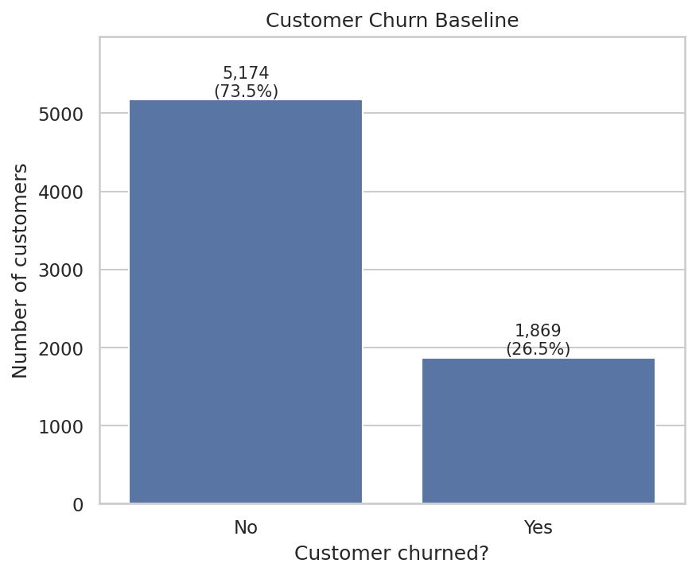
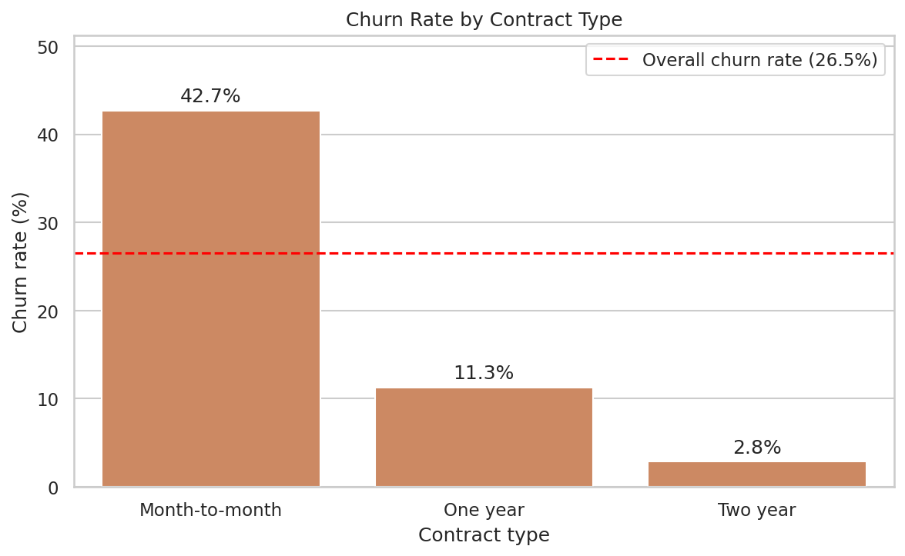
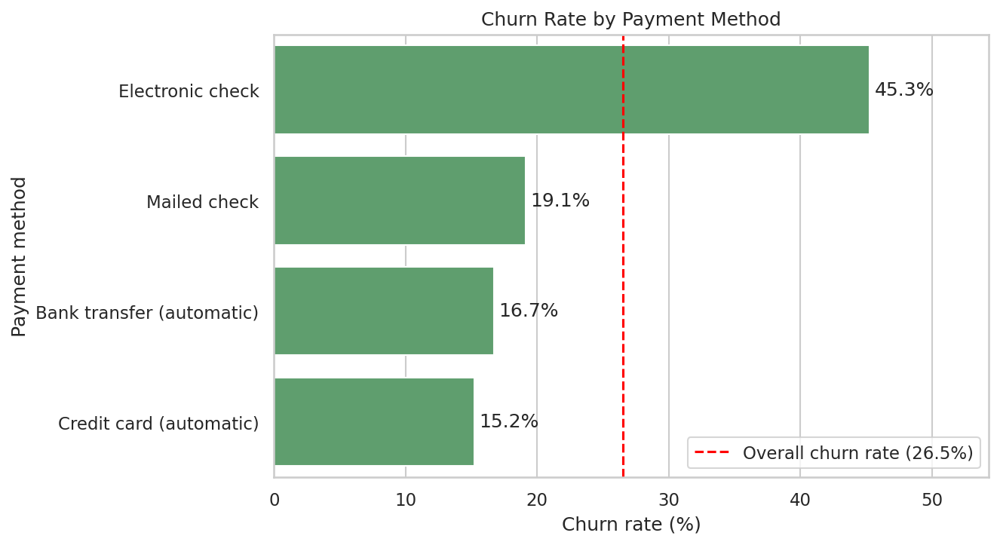

# Customer Churn Storyboard (Guided EDA)

- **Author:** Animireddy Srinu
- **Program:** GetIntern.in 8-Week Practical Data Science & ML Internship
- **Phase 1 Capstone / Week 4 Milestone Project:** Customer Churn Storyboard

## Project Summary
An exploratory data analysis of the **Telco Customer Churn** dataset (7,043 customers, 21 columns) using **Pandas, Matplotlib and Seaborn**. The notebook tells a step-by-step story about customer attrition by answering three business questions:

1. **Overall attrition baseline:** what is the company's churn rate across all customer accounts?
2. **Contract impact:** how much does contract type (Month-to-Month vs One-Year/Two-Year) influence churn?
3. **Billing & payment factors:** does payment method show a visible link with churn?

Every chart in the notebook is followed by a short markdown interpretation of what the data means for the business.

## Repository Contents
| File | Description |
|------|-------------|
| `customer_churn_storyboard.ipynb` | Fully executed notebook with outputs and narrative markdown |
| `WA_Fn-UseC_-Telco-Customer-Churn.csv` | Raw dataset (7,043 rows, 21 columns) |
| `cleaned_telco_churn.csv` | Cleaned dataset with the added `churn_flag` column |
| `churn_baseline.png` | Chart 1: overall churn baseline |
| `churn_by_contract.png` | Chart 2: churn by contract type |
| `churn_by_payment_method.png` | Chart 3: churn by payment method |
| `README.md` | Project documentation |

## Dataset
Source: *Telco Customer Churn* (Kaggle) - https://www.kaggle.com/datasets/blastchar/telco-customer-churn

## Data Preparation
- No duplicate rows and no missing values were found.
- `TotalCharges` was stored as text and had 11 blank values. These belong to new customers with tenure 0 who have not been billed yet, so they were converted to numbers and filled with 0, keeping all 7,043 accounts.
- Text columns were stripped of extra spaces, and a numeric `churn_flag` (1 = churned) was added.

---

# Charts and Key Findings

## Chart 1: Overall Churn Baseline


- Overall churn is **26.5%**: 1,869 of 7,043 customers left, while 5,174 stayed.
- About 1 in 4 customers churns, so 26.5% is the baseline every segment is compared with.

## Chart 2: Churn Rate by Contract Type


- Month-to-month customers churn at **42.7%**, versus **11.3%** for one-year and **2.8%** for two-year contracts.
- Month-to-month customers churn about 15 times more than two-year customers and make up roughly 89% of all churned customers (1,655 of 1,869).
- Moving month-to-month customers onto longer contracts is the clearest retention lever.

| Contract | Customers | Churned | Churn rate |
|----------|----------:|--------:|-----------:|
| Month-to-month | 3,875 | 1,655 | 42.71% |
| One year | 1,473 | 166 | 11.27% |
| Two year | 1,695 | 48 | 2.83% |

## Chart 3: Churn Rate by Payment Method


- **Electronic check** customers churn the most (**45.3%**), while credit card (automatic) and bank transfer (automatic) churn the least (**15.2%** and **16.7%**).
- Electronic check customers churn about 3 times more than automatic payers and make up 57% of all churned customers (1,071 of 1,869).
- The effect holds within every contract type, so payment method matters beyond contract length (table below).

| Payment method | Customers | Churned | Churn rate |
|----------------|----------:|--------:|-----------:|
| Electronic check | 2,365 | 1,071 | 45.29% |
| Mailed check | 1,612 | 308 | 19.11% |
| Bank transfer (automatic) | 1,544 | 258 | 16.71% |
| Credit card (automatic) | 1,522 | 232 | 15.24% |

**Churn rate (%) by payment method within each contract type**

| Payment method | Month-to-month | One year | Two year |
|----------------|---------------:|---------:|---------:|
| Bank transfer (automatic) | 34.1 | 9.7 | 3.4 |
| Credit card (automatic) | 32.8 | 10.3 | 2.2 |
| Electronic check | 53.7 | 18.4 | 7.7 |
| Mailed check | 31.6 | 6.8 | 0.8 |

---

## Key Takeaways
- **Baseline:** 26.5% of customers churn overall.
- **Contracts:** contract length is the strongest driver; month-to-month customers churn at 42.7% versus 2.8% for two-year customers.
- **Payment:** electronic check customers churn the most (45.3%), even within the same contract type.
- **Highest-risk group:** month-to-month customers paying by electronic check churn at 53.7%.

## Recommendations
- Offer discounts or incentives to move month-to-month customers onto one- or two-year contracts.
- Encourage electronic check customers to switch to automatic payment (bank transfer or credit card).

## How to Run
```bash
pip install pandas numpy matplotlib seaborn jupyter
jupyter notebook customer_churn_storyboard.ipynb
```
Place `WA_Fn-UseC_-Telco-Customer-Churn.csv` in the same folder and run all cells from top to bottom.

## Tech Stack
Python 3, Pandas, NumPy, Matplotlib, Seaborn, Jupyter Notebook
